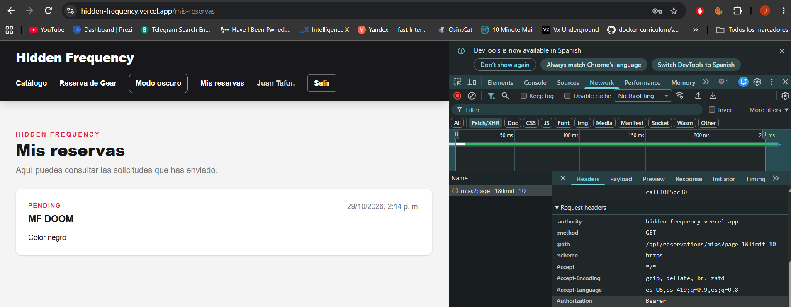

# Hidden Frequency — frontend

Tienda de vinilos, pedales e instrumentos musicales. Esta es la versión de la Entrega 1 reconstruida con Next.js, TypeScript y Tailwind. El catálogo y las reservas se consultan y guardan mediante el backend de Hidden Frequency.

## Enlaces

- Sitio en Vercel: https://hidden-frequency.vercel.app
- API en Render: pendiente de pegar la URL pública del servicio hidden-frequency-back.
- Backend: https://github.com/JuanTafur10/hidden-frequency-back

Confirma que el enlace de Vercel corresponda a este frontend Next.js y no a la versión anterior. Para completar el enlace de la API, abre el servicio en Render, copia su URL pública y úsala como NEXT_PUBLIC_API_HOST, sin añadir /api.

## Ejecutar en tu computador

Necesitas Node.js 20.19 o superior y tener el backend de Hidden Frequency activo.

1. Abre PowerShell en esta carpeta.
2. Instala los paquetes:

    npm install

3. Crea tu archivo local de configuración:

    Copy-Item .env.example .env.local

4. Abre .env.local y confirma esta dirección para desarrollo:

    NEXT_PUBLIC_API_HOST=http://localhost:3001

5. Inicia el frontend:

    npm run dev

6. Abre http://localhost:3000.

Para generar una versión de producción local ejecuta npm run build y luego npm start. No subas .env.local a GitHub.

## Variables de entorno

| Variable | Uso |
| --- | --- |
| NEXT_PUBLIC_API_HOST | Dirección base del backend. En local suele ser http://localhost:3001; en Vercel, la URL pública HTTPS del servicio Render, sin /api. |

En Vercel agrega NEXT_PUBLIC_API_HOST en las variables del proyecto y vuelve a desplegar. El backend debe tener FRONTEND_URL configurada con el dominio exacto de este sitio.

Cuando Vercel esté conectado a este repositorio, los pushes a main deben actualizar el sitio automáticamente. Comprueba que la integración de GitHub y el despliegue automático estén habilitados.

## Cuentas de demostración

Estas cuentas son únicamente para el ambiente de evaluación. Configura los valores equivalentes en las variables SEED_ADMIN_* y SEED_USER_* del backend y ejecuta el seed. Si el backend tiene otras credenciales configuradas, actualiza esta tabla para que coincida.

| Rol | Correo | Contraseña |
| --- | --- | --- |
| Admin | admin@hidden-frequency.test | HF-Admin-Demo-2026! |
| User | usuario@hidden-frequency.test | HF-Usuario-Demo-2026! |

## Cómo está organizado

- app contiene las rutas. Sus páginas montan los componentes de cada vista.
- src/features/common contiene configuración, cliente HTTP, navegación, tema y paginación compartida.
- src/features/auth contiene tipos, servicios, sesión, registro e inicio de sesión.
- src/features/products contiene tipos, consultas, filtros, tarjetas y administración de productos.
- src/features/reservations contiene tipos, servicios, formulario y consulta de reservas.
- src/features/storefront compone la portada y conecta el catálogo con el formulario.

Los componentes no llaman directamente al backend. Las pantallas usan hooks; los hooks usan servicios; y las solicitudes pasan por el cliente HTTP común.

## Decisiones explicadas

### Inicio de sesión y rutas protegidas

Al ingresar, el formulario envía el correo y la contraseña al servicio de autenticación. Next envía la solicitud al backend. Si los datos son correctos, el backend devuelve un JWT y los datos públicos del usuario. Next guarda el JWT en una cookie y devuelve el perfil al frontend. Al refrescar, la aplicación recupera el perfil de sesión desde esa cookie. Las solicitudes posteriores añaden automáticamente Authorization: Bearer al encabezado y Next reenvía el token a la API.

proxy.ts comprueba el vencimiento del token y valida su firma con una ruta privada del backend antes de mostrar /mis-reservas o /admin. También revisa el rol para decidir si permite entrar al panel. La API vuelve a comprobar el token y los permisos antes de entregar o cambiar datos.

### Dónde queda el token y qué riesgo tiene

El JWT queda en la cookie hf_session para que sobreviva al refrescar y lo pueda leer proxy.ts. La cookie es Secure en producción y usa SameSite=Lax. También es legible desde JavaScript porque el cliente HTTP necesita poner el token en Authorization; esto permite ver la petición protegida en la pestaña Network. El riesgo es que un ataque XSS podría leer el token mientras siga vigente. Por eso la interfaz evita insertar contenido HTML no confiable y el backend valida cada operación protegida. No copies el token de la pestaña Network ni lo publiques.

### Diferencia entre 401 y 403

401 significa que la solicitud no trae un token válido, o que el token venció. El cliente HTTP limpia la sesión y lleva al usuario a /login. 403 significa que el token corresponde a un usuario conectado, pero su rol no tiene permiso. Por ejemplo, si un usuario normal intenta eliminar un producto, el backend responde 403; si hace la misma solicitud sin token, responde 401.

### Uso de IA

Usé IA como apoyo para organizar la migración por features, conectar los servicios con la API y revisar los errores de compilación y tipos. Contrasté las rutas y los campos con el backend y ajusté el código cuando los datos reales no coincidían con ejemplos iniciales. Las decisiones y la revisión final del proyecto son mías.

## Captura de Network pendiente

Después de conectar el frontend con la API desplegada:

1. Inicia sesión en el sitio.
2. Abre las herramientas del navegador con F12 y selecciona Network/Red.
3. Entra a Mis reservas. Abre la solicitud GET de /api/reservations/mias.
4. En Headers/Encabezados, dentro de Request Headers, comprueba Authorization: Bearer ….
5. Oculta el valor del token y guarda la captura en docs/captura-network.png.
6. Añade aquí la imagen: .

La captura aún no está incluida porque depende del despliegue del frontend conectado a la API. Las credenciales de evaluación deben ser las cuentas de demostración preparadas por el seed del backend; no uses credenciales personales.
